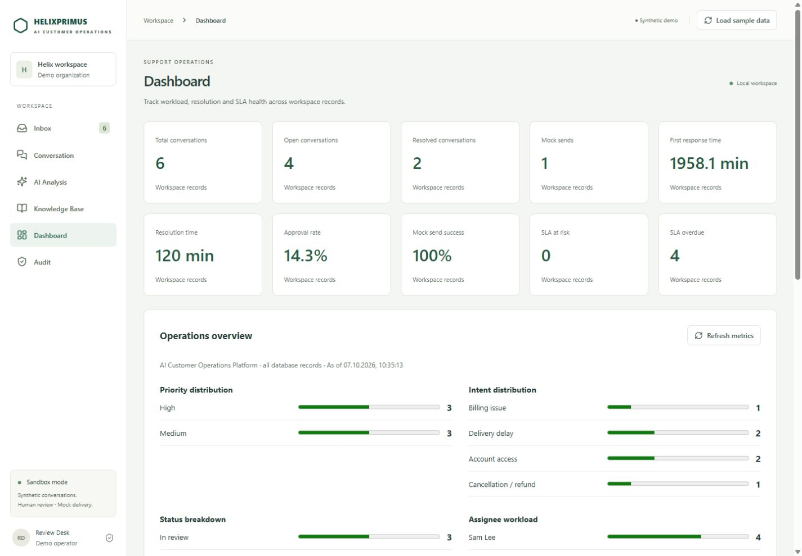
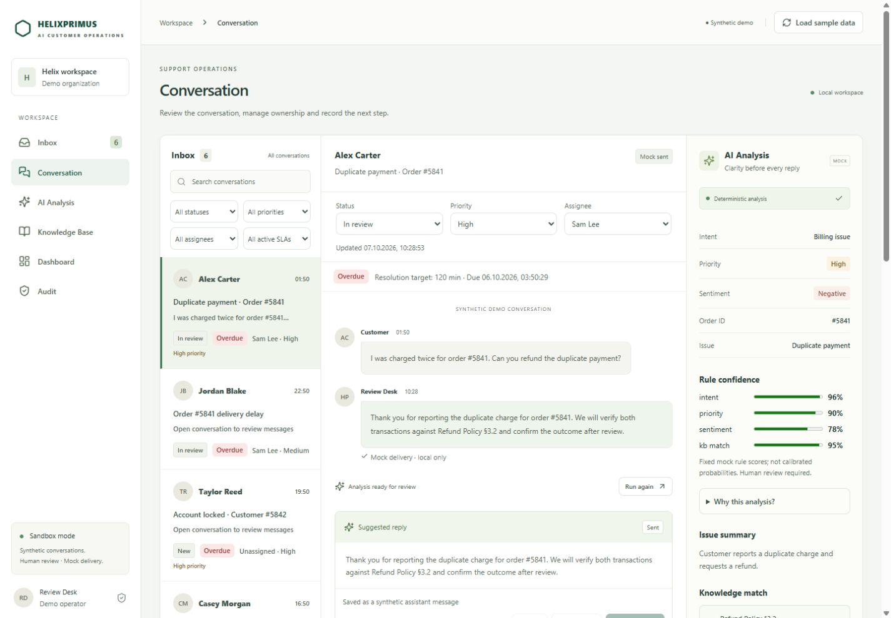
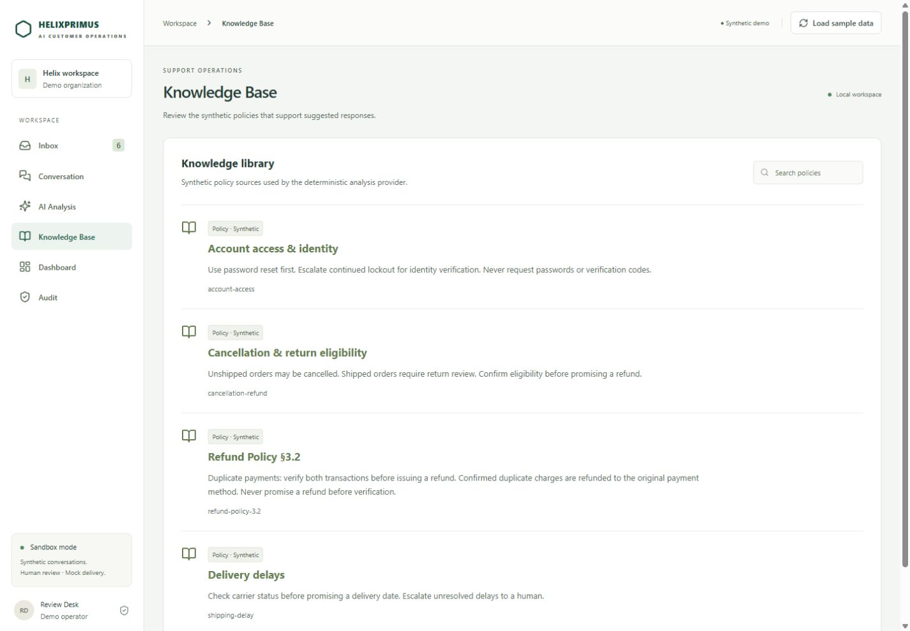

# HELIXPRIMUS — AI Customer Operations Platform

A light B2B workspace that brings customer triage, policy lookup, response review and operational history into one place. HELIXPRIMUS helps an operator understand an issue, find the relevant knowledge, approve a response and keep ownership and resolution visible.

**[Live Demo](https://helixprimus.vercel.app/)** · [Backend health (technical)](https://helixprimus-api.onrender.com/health)

Portfolio-grade demo with synthetic data, deterministic analysis and mock delivery. **Mock Send records a reply; it does not contact a customer.**

## Product walkthrough

**Customer message → AI analysis → KB match → suggested reply → human edit/approve → mock send → audit/timeline**

Open the Dashboard onboarding action or select billing conversation **#5841** in Inbox. Run analysis, inspect the matching policy, then **Edit → Save edits → Approve → Mock Send**. Reload to see persisted history. Editing invalidates approval; sending requires the approved text and repeat sends are blocked.

## Capabilities

- **Inbox:** search and combined status, priority, assignee and active SLA filters.
- **AI Analysis:** issue summary, intent, sentiment, entities, rule explanations and a suggested reply.
- **Knowledge Base:** searchable synthetic policies linked to analysis results.
- **Human review:** editable replies, explicit approval and guarded mock delivery.
- **Operations:** resolution SLA, reassignment, priority changes, New → In review → Resolved transitions and reopening.
- **Internal notes and audit/timeline:** separate team notes and persisted workflow events.
- **Dashboard analytics:** workload, backlog, SLA, status/intent/priority distributions, volume and response/resolution metrics with coverage definitions.
- **EN / RU / UA:** interface language selection persists across reloads.

## Screenshots

Captured from the synthetic demo workspace; illustrative records and metrics are not live customer activity.

### Dashboard


### Conversation and analysis


### Knowledge Base


## Stack and architecture

| Layer | Technology / responsibility |
| --- | --- |
| Frontend | React, TypeScript, Vite; same-origin API proxy |
| Backend | FastAPI; workflow validation and explicit errors |
| Persistence | SQLAlchemy, Alembic; SQLite by default, PostgreSQL-ready schema |
| Analysis | Deterministic provider abstraction; structured provider/version contract |
| Public demo | Vercel frontend, Render backend, temporary shared SQLite |

**Product decisions:** human approval is a persisted workflow gate. A reply and its audit event commit atomically. Internal notes stay separate from customer messages and analysis input. Alembic owns schema creation. SLA and analytics derive from database records; refresh/reload updates time-dependent values.

The implemented provider is `mock`: ordered keyword rules, order-number extraction and exact policy-key matching. It does not use an external model, semantic retrieval or RAG. Confidence values are fixed rule estimates, not calibrated probabilities, and never authorize sending. Unsupported provider values fail explicitly.

## Quick start locally

Prerequisites: Python 3.12, Node.js 22.12+ and pnpm 11. Commands below use Windows PowerShell from the project root.

```powershell
py -3.12 -m venv .venv
.\.venv\Scripts\python.exe -m pip install -r requirements.lock.txt
$env:DATABASE_URL = 'sqlite:///./helixprimus.db'
$env:AI_PROVIDER = 'mock'
.\.venv\Scripts\python.exe -m alembic upgrade head
.\.venv\Scripts\python.exe -m app.demo seed
pnpm --dir frontend install --frozen-lockfile
.\.venv\Scripts\python.exe -m uvicorn app.main:app --host 127.0.0.1 --port 8000
```

In a second terminal, from the project root:

```powershell
pnpm --dir frontend dev
```

Open `http://127.0.0.1:5173/`; API documentation is at `http://127.0.0.1:8000/docs`. Vite dev/preview proxy `/api` and `/health` to the local backend. Set backend environment variables in each backend terminal. `.env.example` is a non-secret reference; `.env` is not loaded automatically. Dependencies are pinned by the Python requirements lock and frontend lockfile.

### Reset sample data

Seed and the UI's Load sample data action are idempotent and preserve existing edits. For a fresh walkthrough, stop the local backend and run:

```powershell
.\.venv\Scripts\python.exe -m app.demo reset
```

Restart the backend and reload the frontend. Reset recreates the six owned synthetic scenarios and clears their interactive approvals/sends; unrelated records and policy edits remain. It anchors sample SLAs to the current UTC minute.

## Verification

- **Backend: 22 tests passed** in the public release verification on 7 October 2026; backend code is unchanged by this README/favicon update.
- **Frontend: 18 tests passed** after this update.
- **TypeScript / Vite production build: PASS** after this update.

```powershell
.\.venv\Scripts\python.exe -m pytest -q -p no:cacheprovider --basetemp=work/pytest-run
pnpm --dir frontend test
pnpm --dir frontend build
```

Backend tests use isolated SQLite databases and real migrations. Frontend component tests use an in-memory API and cover the review flow, persistence, operations and error recovery; they are not browser E2E tests. The build includes TypeScript checking. The pytest temporary directory must contain only disposable test files.

For optional PostgreSQL verification, configure `DATABASE_URL` privately for a disposable loopback database with a name ending in `_smoke`, and set `AI_PROVIDER=mock`:

```powershell
.\.venv\Scripts\python.exe -m alembic upgrade head
.\.venv\Scripts\python.exe -m app.postgres_smoke
.\.venv\Scripts\python.exe -m alembic check
```

The smoke migrates, resets owned synthetic records and exercises the workflow; it refuses non-loopback hosts and databases without the `_smoke` suffix. This public update does not claim a fresh credentialed PostgreSQL run.

## Demo limitations

- Synthetic conversations and policies; deterministic/mock AI and mock delivery only.
- Public demo SQLite is temporary and shared between visitors. Changes can disappear on restart, redeploy or idle spin-down. Cold starts can delay the first request. Use only synthetic data.
- No authentication, RBAC, multitenancy or trusted operator attribution.
- No concurrency guarantees, version checks or realtime collaboration.
- In-process analytics and bounded list views; no large-volume performance claim.
- No real messaging integrations, refunds or other external customer actions.
- Not production-ready. Practical keyboard/accessibility improvements are included; no WCAG compliance claim is made.
